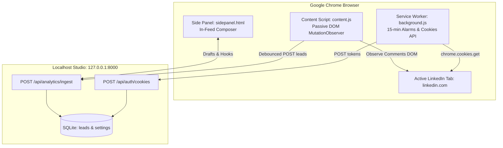

# Chrome Extension & Sync Bridge

The **Inox Hydra Bridge** extension connects the LinkedIn pages you open in your own browser to the studio running on `127.0.0.1:8000`. It reads; it never acts on LinkedIn for you.

---

## 1. Extension Component Architecture

---

## 2. What the Bridge Does in LinkedIn's Page

LinkedIn's User Agreement restricts automated access. The bridge is built to stay a reader of pages you open yourself, and to say plainly what it does there:

| What | How |
| :--- | :--- |
| **Page reading** | Content scripts read the page you have open, as it renders, and follow your own scrolling. They never click, type, post, react, comment, message or connect. |
| **Network reading (off by default)** | Only when you switch on **Read LinkedIn's network responses** in the extension's popup: `voyager_interceptor.js` wraps `window.fetch` in LinkedIn's page and copies the JSON of responses LinkedIn's own app already fetched, for exact rather than rounded figures. It never sends a request of its own. Wrapping fetch is visible to LinkedIn's page code, which may treat it as automation; switch it off to stop at once. |
| **Requests to LinkedIn** | None from the extension. The studio contacts LinkedIn only for features that are off by default, and from your machine, never from a server. |
| **Session** | Copied into the studio only when you press **Sync LinkedIn Session** in the popup, read through `chrome.cookies`, and sealed at rest. |

---

## 3. Passive Commenter & Engager Capture Pipeline

When you browse LinkedIn and view comments or open the reaction modal (Likes/Celebrates) of any post, `content.js` passively observes DOM mutations:

* **Comment Extraction**: Observes comments in feed updates and permalink post views, parsing person names, headlines, profile URLs, and exact comment text.
* **Reaction Modal Extraction**: When you click the reaction count on any post to see who liked/celebrated it, the extension captures all listed reactors into your CRM pipeline as warm engagers.
* **Smart Deduplication**: Re-engaging prospects have their latest context notes updated in SQLite rather than creating duplicate entries.
* **In-Page Feedback**: Displays a subtle toast on LinkedIn when new engagers are ingested (`⚡ Inox Hydra CRM: Ingested X warm engagers!`).

### Lead Extraction Fields:
* **Name**: Sanitized author name.
* **Headline**: Current professional designation (e.g. `VP of Engineering at CloudScale`).
* **Company**: Extracted from headline via regex parsing (`at X` / `@ X`).
* **Profile URL**: Cleaned LinkedIn vanity URL (tracking parameters stripped).
* **Engagement Type**: Categorized as `Commented`, `Liked`, or `Reposted`.
* **Notes**: Quoted comment text or reaction context for personalized 1-on-1 outreach.

---

## 4. Session Sync, When You Ask

Nothing runs on a timer. When you press **Sync LinkedIn Session** in the popup, `studio/extension/background.js`:

1. Reads `li_at` and `JSESSIONID` from Chrome's cookie store.
2. Posts them to `http://127.0.0.1:8000/api/auth/cookies`, with the studio token.
3. The studio seals them at rest. They are used only by the features that need a session, such as staging a post into LinkedIn's scheduler, and the Setup screen shows whether one is held, with a Delete control.

An earlier version copied the session every 15 minutes. That alarm is cleared when the extension starts.

---

## 5. Sidepanel Composer & In-Feed Warm CRM

The extension embeds a lightweight workspace directly into Chrome's native **Side Panel**:
* **Composer Tab**: Draft and format posts with Unicode mathematical sans-bold and insert directly into the LinkedIn composer with 1 click.
* **Queued Posts Tab**: Review your upcoming scheduled publishing queue.
* **Warm CRM Tab**: Browse your active prospect pipeline right alongside LinkedIn. Click **⚡ Copy DM** to generate a personalized outreach message tailored to the prospect's real comments and copy it to your clipboard with one click.

