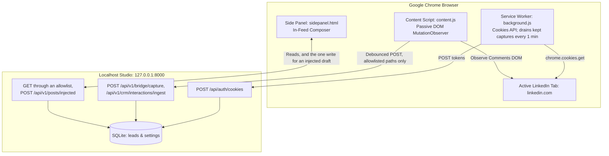

# Chrome Extension & Sync Bridge

The **Inox Hydra Bridge** extension connects the LinkedIn pages you open in your own browser to the studio running on `127.0.0.1:8000`. For everyday reading it never acts on LinkedIn for you; the one exception, covered below, is a history import you start yourself, which clicks LinkedIn's own load-more control and scrolls the page.

---

## 1. Extension Component Architecture

---

## 2. What the Bridge Does in LinkedIn's Page

LinkedIn's User Agreement restricts automated access. The bridge is built to stay a reader of pages you open yourself, with one named exception, and to say plainly what it does there:

| What | How |
| :--- | :--- |
| **Page reading** | Content scripts read the page you have open, as it renders, and follow your own scrolling. Outside the one exception below, they never click, type, post, react, comment, message or connect. |
| **History import (the one exception)** | Only after you press **Import your history** in Setup, for your own posts, comments or reactions, `own_pages.js` clicks LinkedIn's "Show more results" control and scrolls the page itself, so it can read further than what was already on screen. It runs at a randomised pace, 1.6 to 3.2 seconds between rounds, for up to 250 rounds per kind: up to several minutes of unattended clicking and scrolling. A **Stop** control sits on the page the whole time, and the import pauses itself while the tab is not visible. It runs only because you asked for that import, on your own posts, comments or reactions, never on a timer and never on a page that is not yours. This is the exposure the risk register (`planning/7 Roadmap/Risk - LinkedIn terms and detection.md`) names as "the scrolled History Import". |
| **Network reading (off by default)** | Only when you switch on **Read LinkedIn's network responses** in the extension's popup: `voyager_interceptor.js` wraps `window.fetch` in LinkedIn's page and copies the JSON of responses LinkedIn's own app already fetched, for exact rather than rounded figures, and the worker notes which of LinkedIn's data requests a page made (address and status, never contents). It never sends a request of its own. Wrapping fetch is visible to LinkedIn's page code, which may treat it as automation. Switching it off stops the copying at once; an open tab keeps the inert wrapper until reloaded. |
| **Post ids on feed cards** | `card_urns.js` runs in the page, always, and copies each feed card's post id from LinkedIn's React properties onto the card, so the readers know which post a commenter belongs to. It reads and marks the page; it does not touch fetch. |
| **Requests to LinkedIn** | None of the extension's own fetches, outside network reading above. During a history import, clicking LinkedIn's own load-more control makes LinkedIn's page issue its own request to load more of the list; the extension does not make that request itself, but its click is what causes it. Outside the import, the studio itself contacts LinkedIn only for features that are off by default, and from your machine, never from a server. |
| **Session** | Copied into the studio only when you press **Sync LinkedIn Session** in the popup, read through `chrome.cookies`, and sealed at rest. |

---

## 3. Passive Commenter & Engager Capture Pipeline

When you browse LinkedIn and view comments or open the reaction modal (Likes/Celebrates) of any post, `content.js` passively observes DOM mutations:

* **Comment Extraction**: Observes comments in feed updates and permalink post views, parsing person names, headlines, profile URLs, and exact comment text.
* **Reaction Modal Extraction**: When you click the reaction count on a post to see who liked/celebrated it, the extension reads the listed reactors and files them under that post: LinkedIn renders the list outside the post's card, so the post is the one whose card was clicked, or the post page you are on. A list whose post cannot be told is not sent. The studio keeps only people who engaged with your own posts.
* **Smart Deduplication**: Re-engaging prospects have their latest context notes updated in SQLite rather than creating duplicate entries.
* **In-Page Feedback**: Shows a notice on LinkedIn saying what the studio did ("Inox Hydra: N engager(s) on your post captured.", or that it could not be reached and nothing was saved). Notices are announced to screen readers and stay for 6 seconds. People read while the studio was unreachable are offered again 30 seconds later.

### Analytics, and whose they are

LinkedIn's analytics page and its network responses do not say whose figures they show. The extension learns which LinkedIn account the browser is signed in to from your own profile (shown with its owner's edit controls, or reached through `/in/me/`), forgets it when LinkedIn's sign-in cookie changes, and sends it with every analytics reading. The studio keeps a reading only when that account is the profile confirmed in Setup. Figures are read in the page's language, and a follower count is kept whatever range the page shows.

### Lead Extraction Fields:
* **Name**: Sanitized author name.
* **Headline**: Current professional designation (e.g. `VP of Engineering at CloudScale`).
* **Company**: Extracted from headline via regex parsing (`at X` / `@ X`).
* **Profile URL**: Cleaned LinkedIn vanity URL (tracking parameters stripped).
* **Engagement Type**: Categorized as `Commented`, `Liked`, or `Reposted`.
* **Notes**: Quoted comment text or reaction context for personalized 1-on-1 outreach.

---

## 4. Session Sync, When You Ask

Nothing runs on a timer. When you press **Sync LinkedIn Session** in the popup, `studio/extension/background.js`:

1. Reads `li_at` and `JSESSIONID` from Chrome's cookie store.
2. Posts them to `http://127.0.0.1:8000/api/auth/cookies`, with the studio token.
3. The studio seals them at rest. They are used only by the features that need a session, such as staging a post into LinkedIn's scheduler, and the Setup screen shows whether one is held, with a Delete control.

An earlier version copied the session every 15 minutes. That alarm is cleared when the extension starts.

---

## 5. Sidepanel Composer & In-Feed Warm CRM

The extension embeds a lightweight workspace directly into Chrome's native **Side Panel**:
* **Composer Tab**: Draft and format posts with Unicode mathematical sans-bold and insert directly into the LinkedIn composer with 1 click.
* **Queued Posts Tab**: Review your upcoming scheduled publishing queue.
* **Warm CRM Tab**: Browse your active prospect pipeline right alongside LinkedIn. Click **⚡ Copy DM** to generate a personalized outreach message tailored to the prospect's real comments and copy it to your clipboard with one click.

